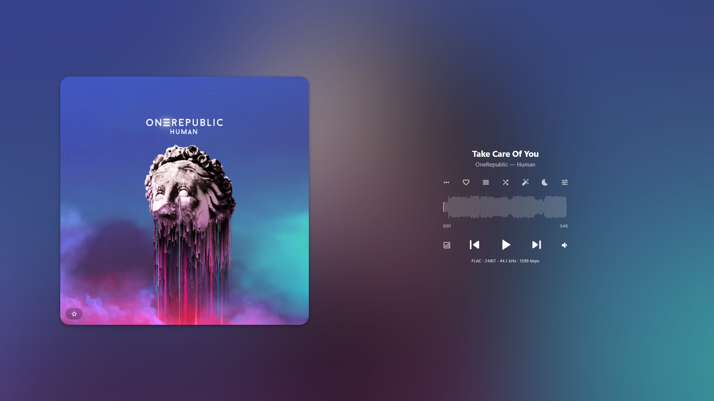
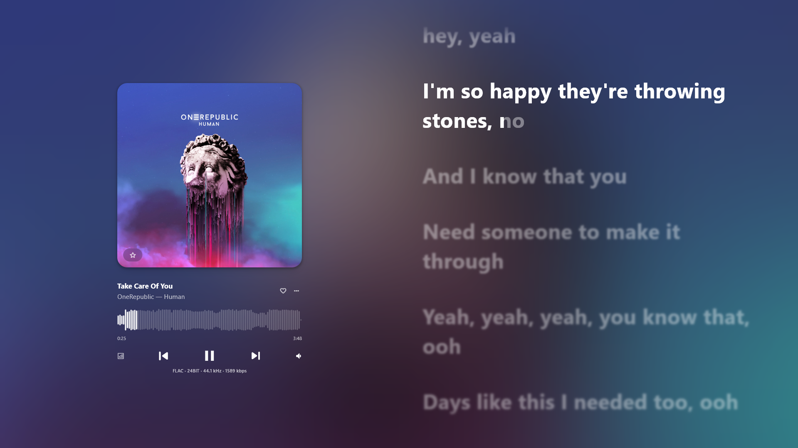
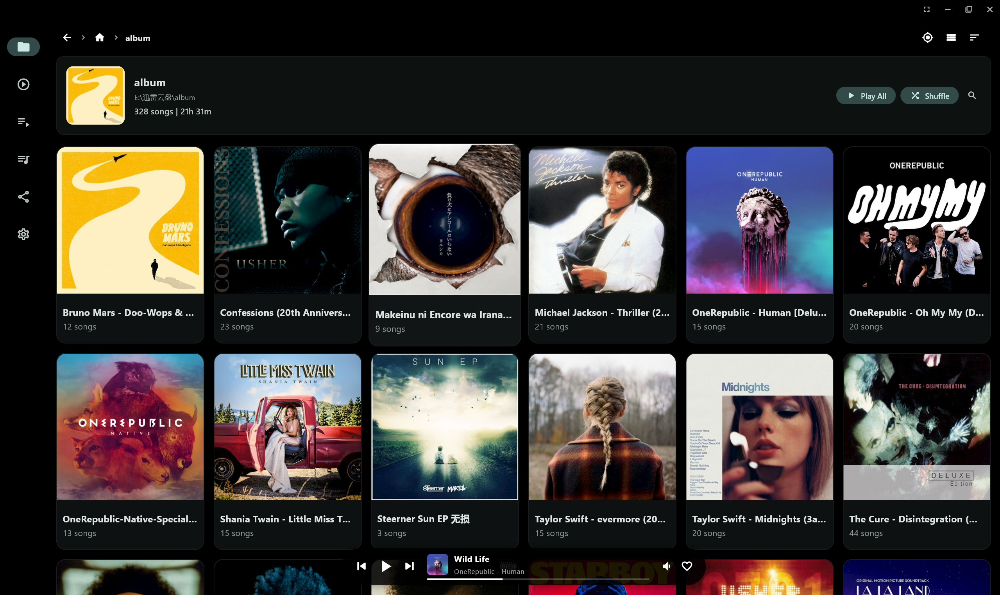
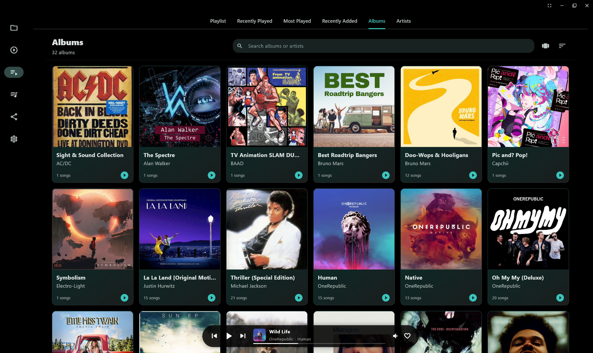
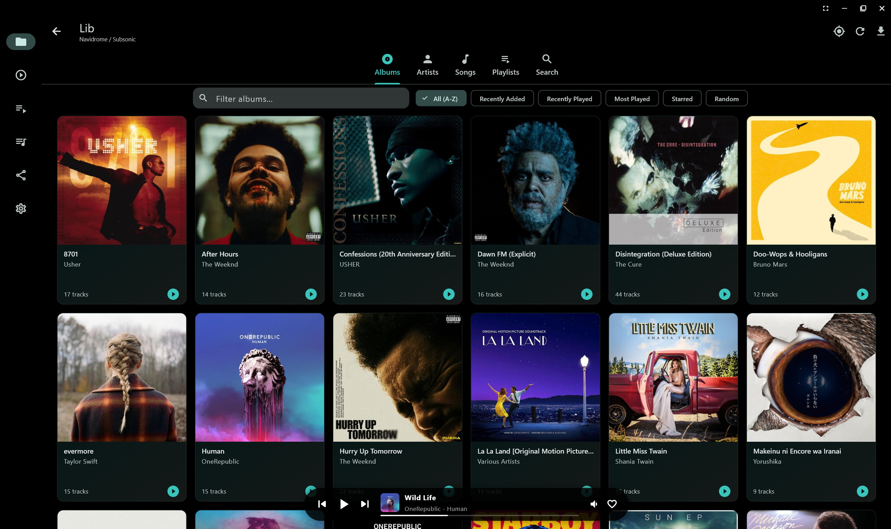
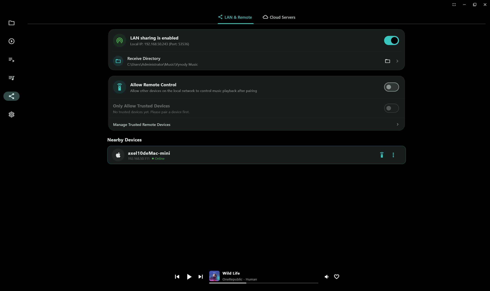
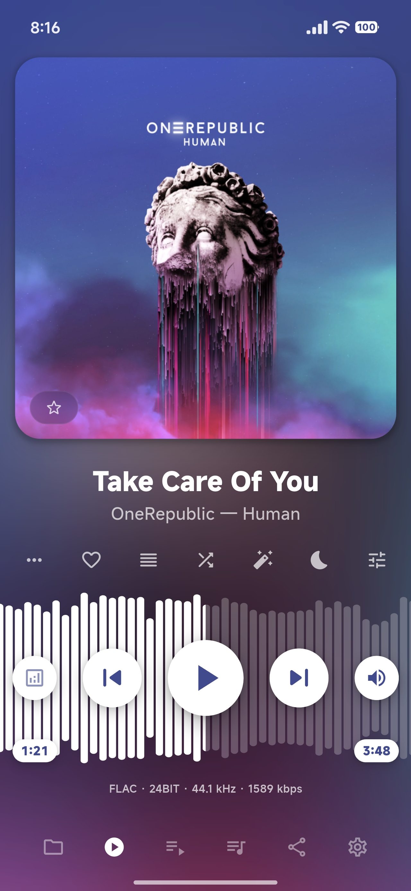
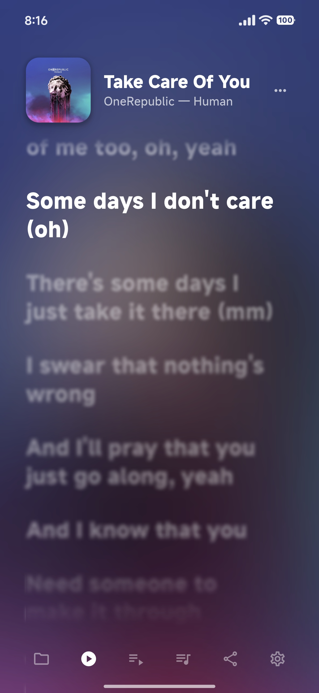
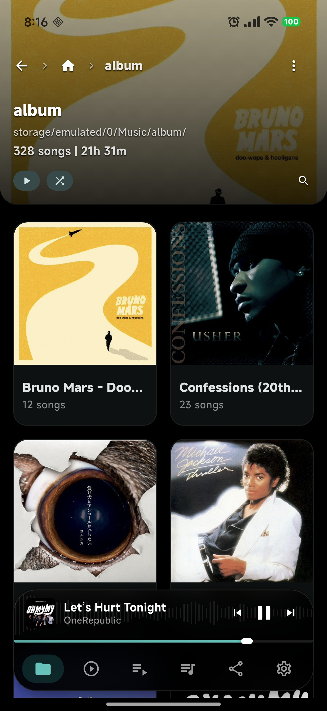

# Vynody

<p align="center">
  
</p>

<p align="center">
  <b>English</b> | <a href="README_zh.md">简体中文</a>
</p>

<p align="center">
  <a href="https://apps.apple.com/app/id6799339894"></a>
  &nbsp;&nbsp;
  <a href="https://apps.microsoft.com/detail/9nmzrzz6rsd3"></a>
</p>

<p align="center">
  <a href="https://flutter.dev"></a>
  <a href="https://www.rust-lang.org"></a>
  <a href="LICENSE"></a>
</p>

---

Vynody is a visually refined, feature-rich, and lightweight cross-platform local music player. Built with Flutter for a sleek modern UI and integrated with platform-specific native audio backends, it delivers a unified experience while unlocking low-level hardware audio capabilities across all platforms.

## Why Vynody?

I am both a music enthusiast and a software developer. For a long time, the local music player ecosystem across different platforms has been severely fragmented—either plagued by dated UIs, bloated resource usage, or jarring inconsistencies across devices. To craft a clean, pure, and cohesive listening experience, I decided to build this application.

Vynody is developed using a modern **Vibe Coding** (AI-assisted development) workflow. After months of intensive iterations and real-device testing, Vynody offers solid stability, maturity, and performance for daily use.

Beyond fast media library indexing, lightweight system footprints, and smooth local playback, Vynody brings **unique and advanced features** rarely found in traditional players:
- **Karaoke-style word-by-word synced lyrics and AI timeline generation**
- **Serverless cross-device LAN syncing for music tracks, playlists, and lyrics**
- **Customizable themes and progress bar visual styles**
- **Deep native platform optimization** across Windows, macOS, Linux, iOS, and Android.

## Downloads

<p align="center">
  <a href="https://apps.apple.com/app/id6799339894"></a>
  &nbsp;&nbsp;
  <a href="https://apps.microsoft.com/detail/9nmzrzz6rsd3"></a>
</p>

| Platform | Channel | Note / Link |
| :--- | :--- | :--- |
| **Windows** | Microsoft Store / GitHub | [Microsoft Store](https://apps.microsoft.com/detail/9nmzrzz6rsd3) · [GitHub Releases (Free)](https://github.com/axel10/vynody/releases) |
| **macOS** | Mac App Store / GitHub | [Mac App Store](https://apps.apple.com/app/id6799339894) · [GitHub Releases (Free)](https://github.com/axel10/vynody/releases) |
| **iOS** | Apple App Store | [Download on App Store](https://apps.apple.com/app/id6799339894) |
| **Android** | GitHub Releases | [Download APK (Free)](https://github.com/axel10/vynody/releases) |
| **Linux** | GitHub Releases | [GitHub Releases (Free)](https://github.com/axel10/vynody/releases) |

## Screenshots

<p align="center">
  
  
  
  
  
  
</p>

<p align="center">
  
  
  
</p>

## Features

- **Full Cross-Platform Native Experience**: Supports Windows, macOS, Linux, iOS, and Android with platform-optimized native audio engines.
- **Windows WASAPI Exclusive Mode**: Direct, bit-perfect audio output bypassing system mixers.
- **Fast Local Library & Instant Indexing**: Intelligent scanning with millisecond-level incremental updates and ultra-low CPU/RAM usage.
- **Audio Fingerprinting & Tag Completion**: Powered by AcoustID and MusicBrainz to identify unknown tracks and automatically fill metadata & high-res artwork.
- **Comprehensive Lyric Capabilities**:
  - **LRCLIB Integration**: Instant lyric search and automatic matching.
  - **AI-Powered Generation**: Generates precise timestamped lyrics with **word-by-word (Karaoke)** sync and timeline corrections.
  - **Multilingual Translation**: One-click translation with dual-language display.
- **Serverless Local Network (LAN) Sync**: Auto-discovery of local instances to seamlessly transfer music files, bidirectionally sync **Playlists**, lyric caches, and translation databases, plus a browser Web interface for instant uploads/downloads.
- **Universal Remote Music Libraries**:
  - **Streaming Servers**: Connect to self-hosted **Navidrome** and **Jellyfin** instances.
  - **Remote Storage**: Mount **WebDAV** and **SMB** shares with on-demand chunked header parsing to immediately display tags without full song downloads.
- **Immersive Visuals & Desktop Interaction**: Real-time audio spectrum, waveforms, dynamic album art color extraction, multiple progress bar styles, desktop queue drawer, and global shortcuts.
- **Sleep Timer**: Countdown timer for automatic bedtime playback shutoff.

## Architecture & Audio Engines

Vynody uses **Flutter** across all platforms for UI presentation and system interaction, paired with platform-tailored native audio backends:

| Platform | Audio Engine | Implementation |
| :--- | :--- | :--- |
| **Windows** | Audio Core (Rust) | Rodio backend integrated with FFmpeg decoding; supports WASAPI Exclusive mode |
| **Linux** | Audio Core (Rust) | Rodio backend integrated with FFmpeg decoding |
| **macOS** | Audio Core (Rust) | Rodio backend, **AVFoundation decoding prioritized with FFmpeg fallback** |
| **iOS** | Audio Core (Rust) | Rodio backend, **AVFoundation decoding prioritized with FFmpeg fallback** |
| **Android** | ExoPlayer (Media3) | Deep buffer output via ExoPlayer for steadier playback and fewer CPU wakeups |

**Core Tech Stack & Integrations:**
- **UI & Architecture**: Flutter 3.x + Riverpod state management
- **Database**: SQLite + Drift for high-speed local indexing and caching
- **Remote Services & Protocols**: LRCLIB (lyrics), Navidrome / Jellyfin (streaming), WebDAV / SMB (remote storage & on-demand metadata parsing)
- **Audio Intelligence**: AcoustID (fingerprints), MusicBrainz (metadata), configurable AI models (lyrics & translation)
- **Networking**: UDP broadcast discovery + embedded HTTP sharing server

## Development & Setup

### Prerequisites
- Flutter SDK (3.x)
- Rust toolchain (with `cargo`)
- Native build toolchain for your target OS (Xcode / Visual Studio / Android SDK & NDK)

### Cloning
```bash
git clone --recurse-submodules https://github.com/axel10/vynody
cd vynody
```
> 💡 *If you cloned without `--recurse-submodules`, run `git submodule update --init` before building.*

### Running
```bash
flutter pub get
flutter run -d <device-id>
```

## Contributing

Issues and Pull Requests are welcome! Before submitting code, please ensure tests pass:

```bash
flutter test
```

## Acknowledgements

Vynody is built upon the shoulders of the open-source community. Special thanks to the following projects, plugins, and services:

- **Audio & DSP**: [Rodio](https://github.com/RustAudio/rodio), [FFmpeg](https://ffmpeg.org/), [ExoPlayer (Media3)](https://github.com/androidx/media), [TagLib](https://github.com/taglib/taglib), and [Freeverb](https://github.com/irh/freeverb-rs) (inspiration for the spatial audio effect)
- **Platform & Desktop Integration**: [`audio_service`](https://github.com/ryanheise/audio_service/tree/minor/audio_service), [`audio_session`](https://github.com/ryanheise/audio_session), [`audio_service_mpris`](https://github.com/bdrazhzhov/audio-service-mpris), [`smtc_windows`](https://github.com/KRTirtho/frb_plugins/tree/main/packages/smtc_windows), [`on_audio_query`](https://github.com/rozpo/on_audio_query), [`window_manager`](https://github.com/leanflutter/window_manager), [`desktop_multi_window`](https://github.com/MixinNetwork/flutter-plugins/tree/main/packages/desktop_multi_window), [`super_drag_and_drop`](https://github.com/superlistapp/super_native_extensions), [`windows_taskbar`](https://github.com/alexmercerind/windows_taskbar), and [`file_picker`](https://github.com/vicajilau/flutter_file_picker/tree/main/packages/file_picker)
- **Visuals & UI**: [`mesh_gradient`](https://github.com/ben-fornefeld/mesh_gradient), and [QueMusic](https://github.com/BroNekoX/QueMusic) (inspiration for the Dynamic Fluid v2 effect)
- **State, Storage & Networking**: [`flutter_riverpod`](https://github.com/rrousselGit/riverpod), [`drift`](https://github.com/simolus3/drift), [`dio`](https://github.com/cfug/dio/blob/main/dio), and [`bonsoir`](https://github.com/Skyost/Bonsoir/tree/main/packages/bonsoir)
- **Online Services**: [LRCLIB](https://lrclib.net/), [MusicBrainz](https://musicbrainz.org/), and [AcoustID](https://acoustid.org/)

## License

Licensed under the [GPL-3.0 License](LICENSE).
